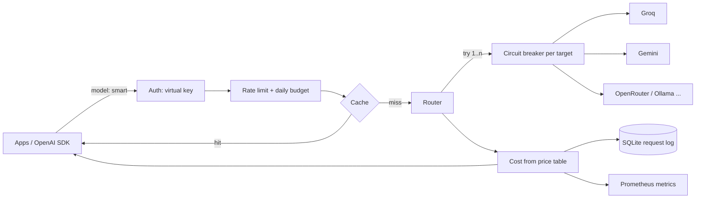

# llm-gateway

[](https://github.com/Tanzil-Ali-Rizvi/llm-gateway/actions/workflows/ci.yml)
[](https://tanzil-llm-gateway.streamlit.app)
[](https://github.com/Tanzil-Ali-Rizvi/llm-gateway/pkgs/container/llm-gateway)


**One OpenAI-compatible API in front of every LLM provider your team uses**: routing with retries, fallback and circuit breakers, a response cache, per-key budgets and rate limits, and per-request cost tracking. Point any OpenAI SDK at it by changing `base_url`.

> When several teams ship LLM features, the same problems repeat in every codebase: one provider has an outage or a 429 storm, nobody knows which feature is burning money, identical questions get paid for again and again, and API keys end up pasted everywhere. A gateway solves them once, in one place.

## What it does

| | |
|---|---|
| **Drop-in API** | `POST /v1/chat/completions` (streaming and non-streaming) and `GET /v1/models`, tested with the official OpenAI Python SDK in CI |
| **Any provider** | Groq, Gemini, OpenRouter, OpenAI, Ollama, vLLM: anything OpenAI-compatible, configured in YAML |
| **Routes, not models** | Apps ask for `smart` or `fast`; the gateway maps each route to an ordered list of `provider/model` targets |
| **Retries and fallback** | Retries 429 / 5xx / timeouts with backoff (honouring `Retry-After`), then falls back to the next target. Client errors (400, 422) are returned at once instead of being retried |
| **Circuit breakers** | After N consecutive failures a target is skipped for a cooldown, then probed with one trial call |
| **Cache** | Exact-match cache for deterministic (temperature 0) requests, replayed as a stream if the client streams. Optional semantic cache with a measured threshold |
| **Virtual keys** | Per-team `sk-gw-...` keys (only hashes stored) with daily USD budgets, requests-per-minute limits and allowed routes |
| **Cost tracking** | Tokens and USD per request from a price table, plus spend avoided by the cache. Every response carries `x-gateway-*` headers |
| **Observability** | Request log (SQLite), `/admin/usage` by route, provider, key or day, Prometheus `/metrics`, circuit status |
| **Chaos testing** | Fault injection in front of any real provider, to rehearse outages in staging |

## Benchmarks

Reproducible with simulated providers (no API keys): `python benchmarks/chaos.py`. Results also run in [CI](.github/workflows/benchmarks.yml) and are committed in [`benchmarks/results/`](benchmarks/results/). Failures are seeded, but which request hits them depends on concurrent scheduling, so success rates move by about ±0.2 points between runs (the CI run gave 81.8% / 96.4% / 100%).

**Flaky primary provider (20% of calls fail with HTTP 503), 1,000 requests, 25 concurrent clients**

| Setup | Success | p50 | p95 |
|---|---|---|---|
| App calls the provider directly | 81.9% | 301 ms | 392 ms |
| Gateway, retries only | 96.2% | 320 ms | 702 ms |
| **Gateway, retries + fallback** | **100%** | 328 ms | 789 ms |

**Primary provider completely down**

| Setup | Success | p50 | p95 | Upstream calls for 1,000 requests |
|---|---|---|---|---|
| Fallback without circuit breaker | 100% | 1,100 ms | 1,299 ms | 3,000 |
| **Fallback + circuit breaker** | **100%** | **457 ms** | **593 ms** | **1,029** |

Without a breaker, every request first wastes two calls on the dead provider. With it, the gateway stops calling after 5 failures and probes again after the cooldown.

**Support-bot FAQ workload (2,000 requests, 300 distinct questions, Zipf popularity)**

| Setup | Spend | Upstream calls |
|---|---|---|
| No cache | $0.0322 | 2,000 |
| **Exact-match cache** | **$0.0041 (−87%)** | **251** |

Savings depend on how repetitive your traffic is; the request log reports the real figure as `saved_usd`.

**Semantic cache: how often would it serve the wrong answer?** Measured in CI on 4,000 Quora Question Pairs (validation split) with `bge-small-en-v1.5`. A "wrong answer" is a pair of different questions whose similarity clears the threshold, so the cache would replay one question's answer for the other.

| Threshold | Paraphrases served from cache | Different questions wrongly served | Precision of hits |
|---|---|---|---|
| 0.85 | 80.9% | 22.6% | 68.8% |
| 0.90 | 58.6% | 10.8% | 76.9% |
| 0.94 | 34.2% | 3.2% | 86.7% |
| **0.96** | **21.9%** | **1.3%** | **91.0%** |
| 0.98 | 12.4% | 0.3% | 95.9% |

Thresholds around 0.85 that are common in tutorials would give a wrong answer to roughly 1 in 5 distinct questions on this data. The gateway therefore ships the semantic layer **off by default**, recommends 0.96 or higher when enabled, and only matches within the same route, system prompt, history and parameters. Full table and the closest non-duplicate pairs: [`semantic_threshold.md`](benchmarks/results/semantic_threshold.md).

## Quick start

```bash
export LLMGW_MASTER_KEY=$(openssl rand -hex 16)
docker run -p 8080:8080 -e LLMGW_MASTER_KEY -e GROQ_API_KEY=... ghcr.io/tanzil-ali-rizvi/llm-gateway:latest
# or:  pip install -e . && llmgw serve --config config/gateway.yaml
```

Create a key for a team (shown once):

```bash
curl -X POST localhost:8080/admin/keys -H "Authorization: Bearer $LLMGW_MASTER_KEY" \
  -H "content-type: application/json" -d '{"name": "support-bot", "daily_budget_usd": 5, "rpm_limit": 60}'
```

Use it from any OpenAI client:

```python
from openai import OpenAI

client = OpenAI(base_url="http://localhost:8080/v1", api_key="sk-gw-...")
resp = client.chat.completions.with_raw_response.create(
    model="smart", messages=[{"role": "user", "content": "Summarise this ticket ..."}], temperature=0)
print(resp.parse().choices[0].message.content)
print(resp.headers["x-gateway-target"], resp.headers["x-gateway-cost-usd"], resp.headers["x-gateway-cache"])
```

No API keys? `LLMGW_CONFIG=config/demo.yaml` runs everything on simulated providers.

## Configuration

```yaml
providers:
  groq:
    type: openai
    base_url: https://api.groq.com/openai/v1
    api_key_env: GROQ_API_KEY            # secrets stay in the environment
    models:
      openai/gpt-oss-120b: {input_per_1m: 0.15, output_per_1m: 0.60}
  gemini:
    type: openai
    base_url: https://generativelanguage.googleapis.com/v1beta/openai
    api_key_env: GEMINI_API_KEY
    models:
      gemini-2.5-flash: {input_per_1m: 0.30, output_per_1m: 2.50}
routes:
  smart: [groq/openai/gpt-oss-120b, gemini/gemini-2.5-flash]
cache: {enabled: true, semantic: false}
breaker: {failure_threshold: 5, cooldown_s: 30}
retry: {attempts_per_target: 2, backoff_s: 0.25, max_retry_after_s: 5}
```

Full example: [`config/gateway.yaml`](config/gateway.yaml). Clients can also address a target directly (`"model": "groq/openai/gpt-oss-20b"`) and control caching per request with `x-gateway-cache: no | auto | force`.

## Design decisions

- **Streams fall back only before the first token.** After that the client has partial output, so switching providers mid-answer would produce a mixed response.
- **Not every error is retried.** 429 / 5xx / timeouts are retried and then fall back; 401 / 403 / 404 skip to the next target (one provider's key or model is broken); 400 / 422 go straight back to the client, because every provider would reject the same request.
- **A 429 is not always a 503.** If every target was rate limited, the client gets 429, so its own backoff logic works.
- **The cache is conservative.** By default only temperature-0 requests are cached, and the key covers every generation parameter (messages, max_tokens, tools, response_format ...), so different requests never share an answer.
- **Keys are never stored.** Only SHA-256 hashes; the raw key is shown once at creation.

## API

| Endpoint | Purpose |
|---|---|
| `POST /v1/chat/completions` | OpenAI-compatible chat (stream or not) |
| `GET /v1/models` | Routes available to the key |
| `POST /admin/keys`, `GET /admin/keys`, `DELETE /admin/keys/{id}` | Manage virtual keys (master key) |
| `GET /admin/usage?group_by=route\|provider\|key\|day\|cache` | Requests, tokens, spend, savings, fallbacks, latency |
| `GET /admin/requests`, `GET /admin/circuits` | Recent requests, circuit-breaker states |
| `GET /metrics`, `GET /health` | Prometheus metrics, health check |

Response headers: `x-gateway-route`, `x-gateway-target`, `x-gateway-cache`, `x-gateway-cost-usd`, `x-gateway-saved-usd`, `x-gateway-attempts`, `x-gateway-fallback`, `x-gateway-latency-ms`.

## Architecture



```
src/llmgw/
  app.py           FastAPI: OpenAI-compatible, admin and ops endpoints
  gateway.py       request pipeline: auth, limits, budget, cache, routing, cost, logging, metrics
  router.py        retries, fallback, circuit breaker
  cache.py         exact + semantic cache
  store.py         SQLite: keys, request log, cache
  providers/       OpenAI-compatible adapter, mock provider, fault injector
dashboard/app.py   live demo: playground, outage simulator, load test, spend dashboard
benchmarks/        chaos/cache benchmark, semantic-cache threshold study
```

## Testing

`pytest`: 34 tests covering routing, retries, Retry-After, circuit breaking and half-open trials, client-error handling, streaming fallback and replay, cache keys, the semantic cache, budgets, rate limits, allowed routes, key revocation and metrics. The OpenAI adapter is tested against a fake upstream (`httpx.MockTransport`), with no network. CI also runs the official OpenAI SDK against a real server, and builds and smoke-tests the Docker image.

## Limitations

- One instance: the request log is SQLite and the rate limiter is in memory. Running several replicas would need Postgres and Redis behind the same interfaces.
- Budgets are checked before a request and charged after it, so one in-flight request can overshoot a budget slightly.
- Token counts come from the provider; when a provider does not report usage, the gateway estimates (about 4 characters per token).
- Prices in the example config are as published in October 2026; check each provider's pricing page.

## License

MIT © 2026 Tanzil Ali Rizvi
